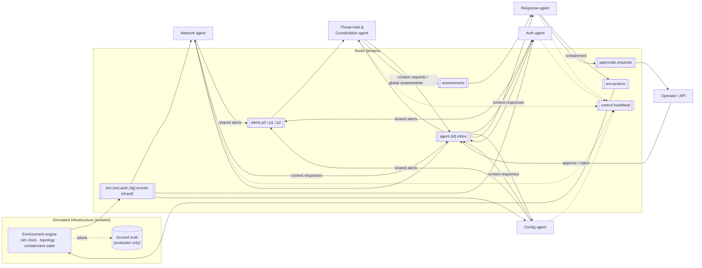

# Multi-Agent Cyber Defense System for Distributed Detection & Response

A research prototype of a **decentralized multi-agent cyber-defense framework**. Autonomous defensive agents detect suspicious activity locally, share only partial information (alerts, bounded context summaries), coordinate decisions, and execute **simulated** containment in an isolated, reproducible model of a small critical-infrastructure site.

> ⚠️ **Research prototype, not production-ready.** All infrastructure, attacks and responses are synthetic. Nothing here touches real systems. The default deployment has no authentication or TLS between components.

---

## Contents

1. [What the system does](#what-the-system-does)
2. [Architecture](#architecture)
3. [Agents](#agents)
4. [Communication protocol](#communication-protocol)
5. [Detection (ML + rules)](#detection)
6. [Cooperative decision-making](#cooperative-decision-making)
7. [Attack simulation](#attack-simulation)
8. [Response & human-in-the-loop](#response--human-in-the-loop)
9. [Installation](#installation)
10. [Running](#running)
11. [Experiments](#experiments)
12. [Tests](#tests)
13. [Repository layout](#repository-layout)
14. [Limitations](#limitations)

Full design document, including the protocol, message schemas, algorithms and methodology: **[docs/ARCHITECTURE.md](docs/ARCHITECTURE.md)**.

---

## What the system does

| Capability | Implementation |
|---|---|
| ≥ 5 autonomous agents | Network, Authentication and Configuration sensors (shardable), a Threat-Intelligence & Coordination agent, and a Response agent. A simulated operator is used for unattended experiments. |
| Genuine inter-agent communication | Async message broker with consumer groups. Redis Streams in deployment; an in-memory transport with identical semantics for tests. Messages are always serialized to bytes, so agents share no objects. |
| Partial information sharing | Raw observations never leave the sensor that collected them. Sensors share alerts above a threshold, rate-limited and deduplicated, and answer targeted context requests with bounded summaries. |
| Local ML detection | Per agent: Isolation Forest, Local Outlier Factor, per-entity EWMA z-scores, and declarative YAML rules. |
| Coordination strategies | **Independent** (local decisions), **Cooperative** (correlation, fusion, value-of-information queries, advisories), and a **Centralized** baseline. |
| Attack scenarios | A credential compromise, B lateral movement, C configuration tampering, plus an A→B→C multi-stage campaign. All run on benign background traffic that includes realistic confounders. |
| Response | Policy plus blast radius, human approval for critical actions with a safe timeout fallback, outcome evaluation, and a hash-chained audit log. |
| Evaluation | Eight experiment suites (E1–E8) with paired seeds, bootstrap confidence intervals, Wilcoxon tests with Holm correction, and Plotly figures. |
| Ops | FastAPI, a Streamlit dashboard, Docker Compose (one container per agent), and pytest. |

---

## Architecture



There are three levels of information, each with its own message type:

| Level | Message type | Visible to |
|---|---|---|
| Local observation | `Observation`, feature windows | the owning sensor only |
| Shared alert | `LocalAlert`, `ContextResponse` | the coordinator (or the response agent, in independent mode) |
| Global assessment | `ThreatAssessment` | the response agent, API and dashboard |

Each agent is an independent asyncio component with:
- a reader task per subscription;
- a bounded priority queue;
- a worker that acknowledges a message only after handling it successfully;
- a heartbeat.

Delivery is at-least-once. Repeated deliveries are skipped by message id. Expired messages are dropped. A message that keeps failing goes to a dead-letter queue after N attempts, and pending messages are recovered after a crash.

---

## Agents

| Agent | Observes (private) | Shares | Acts |
|---|---|---|---|
| **Network** (`net-k`) | Flow records of the hosts in its shard | Fan-out, novel peers, admin-port access towards critical segments, sweeps | Applies a sensitivity boost when it receives an advisory |
| **Authentication** (`auth-k`) | Login events of the users in its shard | Brute force, success after failures, privileged account from a novel source, novel critical access | Same |
| **Configuration** (`cfg-k`) | Config changes of the hosts in its shard | Unticketed critical changes, privilege grants, drift, audit disabled, unknown actor | Same |
| **Threat-Intel & Coordination** (`intel-0`) | Alerts, context, reports and heartbeats only. **Never raw data.** | Assessments; targeted context requests; advisories | Coordination only |
| **Response** (`response-0`) | Assessments (or local alerts in independent mode), approvals, acknowledgements | Reports, approval requests, audit entries | Containment commands to the simulated environment |

Sharding uses `crc32(entity) mod n`: hosts for the network and config agents, users for the auth agent. The shard map is public configuration. Each agent's private state is not.

---

## Communication protocol

- **Envelope** (Pydantic): `message_id` (time-sortable), `correlation_id`, `causation_id`, `type`, `sender`, `recipient`, `topic`, `priority`, `severity`, `sim_time`, `created_at`, `expires_at`, `hop_count`, `payload`.
- **Priority lanes:** `alerts.p0/p1/p2`, mapped from severity and read in order. Directed inbox messages are reordered locally by priority.
- **Communication constraints** (`CommunicationPolicy`):
  - a share threshold;
  - a suppression window per (entity, alert type), with merged repeats counted in `count`;
  - a token-bucket rate limit, which P0 messages bypass;
  - a maximum payload size.
- **Fault injection** (`ConditionedBroker`): delay, jitter, random loss, and partitions by sender and topic pattern. Experiments use it; agent code does not change.

---

## Detection

Each sensor runs the same windowed pipeline (60 sim-seconds per entity) on its own data:

```
observations → domain features → { Isolation Forest, LOF (novelty), EWMA z-score } → calibrated anomaly score a ∈ [0,1]
                               → YAML rules → rule confidence r (noisy-OR)
local threat confidence c = 1 − (1 − α·a)(1 − r)        (α = 0.6: a pure anomaly can never exceed 0.6)
```

- **Training is unsupervised**, on the agent's own shard of a benign history generated with a seed disjoint from the evaluation seeds. The first half of the history learns baselines (known peers, sources). The second half produces the training feature rows.
- **Calibration:** each component's score is mapped to its percentile among training scores. `a = clip((p − 0.9)/0.1, 0, 1)` measures how far into the benign tail a window falls. It is **not** a probability of maliciousness.
- **Anomaly vs malicious:**
  - Sensors can only label a window `ANOMALY` (statistical) or `SUSPICIOUS` (a rule fired, or an extreme anomaly).
  - Only the coordinator can label an incident `CORROBORATED` or `CONFIRMED`.
  - "Confirmed" means *the system's* conclusion. Ground truth is checked separately, by the evaluator.
- **Explanations:** the IDs of the rules that fired, plus the top features ranked by |z| against the baseline.

---

## Cooperative decision-making

The coordinator correlates alerts into **incidents**: groups of alerts connected through shared entities. Shared-service hosts and sweep-like alerts never merge incidents. For each incident it computes:

1. Keep the maximum confidence per (domain, alert type, entity).
2. Apply exponential time decay.
3. Weight each domain by its reliability.
4. Combine with noisy-OR: `S = 1 − Π(1 − w_d·c_i)`.
5. Add a kill-chain coherence bonus: `S' = 1 − (1 − S)·γ^(k−1)`, where `k` is the length of the longest time-ordered stage chain.

**Decision.** An incident is **CORROBORATED** (actionable) if `S' ≥ τ_confirm`, *and*:
- either ≥ 2 domains agree *and* there is either a ≥ 2-stage chain or a strong rule (≥ 0.7);
- or one rule is high-fidelity (≥ 0.95).

Otherwise it is SUSPICIOUS: the coordinator **pulls targeted context** from the owners of related entities, but only if a strong answer could push the incident to τ_confirm (value of information). It also sends sensitivity advisories to those owners.

The independent strategy acts on any local alert ≥ `τ_act`. The centralized baseline runs the same pipelines and fusion on all raw data in one node.

---

## Attack simulation

The topology has four segments: DMZ, CORP (workstations, admin workstations, a vulnerability scanner), SERVERS (DC, file, web, DB, app, mail, backup, jump) and OT (HMI, SCADA, PLC gateway). Each has a criticality from 1 to 3.

**Benign activity** includes deliberate **confounders**, so that false-positive rates are meaningful:
- a vulnerability scanner sweeping admin ports;
- hourly backup fan-out;
- admin sessions to new servers;
- emergency changes made without a ticket;
- password typos.

| Scenario | Footprint |
|---|---|
| **A** credential compromise | Brute force against several accounts → success on a privileged account → logins and RDP to never-used servers |
| **B** lateral movement | Admin-port scans → stolen-credential logins → pivot and dwell → CORP→SERVERS→OT |
| **C** configuration tampering | Login from an unusual host → unticketed firewall/sudoers/services changes, privilege grants, drift, audit disabled; re-tampers after a revert |
| **Multi-stage** | A→B→C sharing the foothold and stolen account |

Parameters: `start`, `duration`, `intensity`, `n_hosts`, `n_users`, `stealth`, `dwell_steps`, plus `count` and `spacing` for frequency.

The environment **reacts to containment**: an isolated host emits nothing, and a suspended account's logins fail. Attacks therefore halt for real, and their benign collateral is counted. Labels are kept only in the ground-truth store. A test checks that no label field leaks into observations.

---

## Response & human-in-the-loop

| Implicated entity | Action | Blast radius |
|---|---|---|
| user | `SUSPEND_ACCOUNT` | high if privileged |
| host (network evidence) | `ISOLATE_HOST` | high if criticality ≥ 2 |
| host (config evidence) | `REVERT_CONFIG` | medium |
| non-actionable, severity ≥ MEDIUM | `INCREASE_MONITORING` | low |

- **High blast-radius actions require approval.** The operator approves them through the API or dashboard. In unattended experiments a simulated operator does it instead (`AutoApprover`), and the results say so.
- **On timeout, the action never executes.** The agent falls back to `INCREASE_MONITORING` and `ESCALATE_HUMAN`. A test checks this.
- **Outcome evaluation:** after an action executes, the agent watches for related decisions during a post-action window. This self-assessment is compared with ground truth (`self_assessment_agreement`).
- **Audit log:** append-only JSONL with a SHA-256 hash chain. Each entry records the detected threat, responsible agent, evidence, confidence, selected response, execution time and outcome. `AuditLogger.verify` detects tampering.

---

## Installation

```bash
git clone <this repo> && cd multi-agent-cyber-defense
python -m venv .venv && . .venv/bin/activate      # Windows: .venv\Scripts\activate
pip install -r requirements.txt
pip install -e .
```

Requires Python 3.11+. Redis is only needed for the multi-process deployment. Everything else runs on the in-memory broker.

## Running

```bash
# 1) Whole system in one process (in-memory broker): prints detection metrics vs ground truth
python -m mcd.runtime.launch --role local --config configs/system.yaml

# 2) Distributed: one container per agent over Redis Streams
docker compose up --build

# 3) API + dashboard (the API runs an embedded simulation you control from the UI)
uvicorn mcd.api.main:app --port 8000
streamlit run dashboard/app.py            # http://localhost:8501
#   or: docker compose --profile ui up --build
```

**Main API endpoints:**
- `POST /simulation/start`, `GET /simulation/status`
- `GET /agents`, `/events/recent`, `/alerts`, `/incidents`, `/actions`, `/audit`, `/communications`, `/metrics`
- `GET /approvals`, `POST /approvals/{action_id}`
- `WS /ws`

**The dashboard shows:**
- active agents and their health;
- incoming events;
- detected anomalies and alerts;
- the severity distribution;
- cooperative decisions;
- the agent-interaction graph, with edge width proportional to messages;
- threat propagation (incidents and the hosts/users they implicate);
- pending approvals with approve/reject buttons;
- actions and the audit log;
- final detection metrics;
- offline experiment reports.

*Screenshots: none are included yet. Capture them after a local run (`docs/screenshots/`).*

## Experiments

```bash
python -m mcd.evaluation.experiments --all                 # E1–E8 → results/<suite>/
python -m mcd.evaluation.experiments configs/experiments/e1_strategies.yaml --seeds 100 101 102
```

| Suite | Question | Variable |
|---|---|---|
| E1 | Does cooperation help? | strategy × scenario (A, B, C, multi-stage) |
| E2 | Scalability | 2 / 4 / 8 / 16 sensor agents, with the infrastructure scaled accordingly |
| E3 | Agent failures | crash of a sensor or the coordinator, with or without restart |
| E4 | Communication delay | 0 / 100 / 500 / 2000 ms |
| E5 | Partial disconnection | partitioned sensor group; 10 / 30 / 50 % message loss |
| E6 | Missing observations | 0 / 10 / 25 / 50 % events dropped |
| E7 | Noisy input | attribute noise + benign bursts |
| E8 | Ablation | drop IF / LOF / stat / rules / ML / VOI / advisories / kill-chain bonus |

**Each suite writes to `results/<suite>/`:**
- `rows.csv`: one line per run;
- `summary.csv`: mean and 95 % bootstrap CI;
- `tests.csv`: paired Wilcoxon tests with Holm correction and rank-biserial effect size;
- `figures/*.html`: Plotly figures;
- `report.md`;
- `manifest.json`: seeds, git commit, platform.

**Protocol:**
- Seeds 1–5 were used during development, to tune thresholds and fusion rules. The test seeds are 100–109 and were not used for tuning.
- Strategies are compared on identical seeds (a paired design).

**Metrics:**
- **Precision, recall (detection rate), F1 and FPR**, counted over unique (entity, 60 s window) pairs flagged by actionable decisions and checked against ground truth.
- **Detection latency**, in sim-seconds and wall-seconds.
- **Containment rate.**
- **Coordination overhead**, in messages and KB per sim-hour, with raw-event ingestion reported separately.
- **Message delivery latency, handler time, CPU time and peak RSS.**

> **Results are not included in this repository.** No benchmark numbers are reported here, because the full suites have not been executed for this commit. Run the command above to produce them. Every number in the generated reports comes from those runs.

## Tests

```bash
pytest                  # unit + integration (Redis contract tests run only if REDIS_URL is set)
pytest -m "not slow"    # skip end-to-end simulations
```

The tests cover:
- envelope serialization and expiry;
- broker contract (ack, consumer groups, reclaim, replay, trimming);
- fault injection and the communication policy;
- base-agent reliability (dedup, priority, retry → DLQ, crash/restart recovery, TTL);
- detectors, calibration and rules;
- fusion math, hub handling and the VOI gate;
- determinism of the simulator and absence of label leakage;
- the containment effects;
- response policy, the approval guarantee and audit-chain tamper detection;
- metrics and statistics;
- the context protocol between real agents;
- end-to-end runs of all three strategies, crash/restart, and sharding.

## Repository layout

```
src/mcd/
  core/            enums, Pydantic message payloads, asset inventory, ids
  communication/   envelope, broker ABC, transports (memory, Redis Streams), fault injection,
                   communication policy, topics/sharding, coordination (correlation & fusion)
  agents/          base agent, sensor agent + network/auth/config agents, intelligence agent, response agent
  detection/       feature extractors, hybrid anomaly detector, rule engine, threat scoring, pipeline
  simulation/      topology, benign activity, scenarios A/B/C/multi-stage, environment, ground truth, training data
  response/        response engine (policy, blast radius), approvals, hash-chained audit log
  baseline/        centralized detector
  evaluation/      metrics, statistics, visualizations, experiment runner
  runtime/         system assembly, per-process launcher, resource sampling
  api/             FastAPI service + read-only observer
dashboard/app.py   Streamlit dashboard
configs/           rules.yaml, system.yaml, experiments/e1..e8.yaml
tests/             unit/ and integration/
docs/              ARCHITECTURE.md
```

## Limitations

- **Synthetic data.** Detection performance describes this simulator, not real networks. The attack generators and the detectors were designed by the same author, which risks optimistic coupling. Benign confounders and the `stealth` parameter reduce this risk but do not remove it.
- **Hand-set parameters.** Thresholds, rule confidences and domain weights were set by hand during development (seeds 1–5). They were not learned, and they are not formally tuned with cross-validation.
- **Legitimate admin activity remains a hard case.** It can look like lateral movement in two domains at once. The corroboration rule mitigates this but does not eliminate it.
- **The coordinator is a logical single point** for cooperative correlation. Sensors keep working when it is down, but cooperative decisions stop until it restarts. Sharded or gossip coordinators are future work.
- **Delays in sim time depend on wall-clock speed.** Wall-clock delays map to simulation time through the `speedup` factor. Message latency is measured on a single host, and clock skew is not modelled.
- **Shared process metrics.** When agents run in a single process, CPU and memory figures are per process, not per agent.
- **Untested in this environment.** The Redis transport and the Docker deployment were written against the documented APIs but not executed here. The in-memory transport, which implements the same contract, is what the tests exercise.
- **Simulated human-in-the-loop.** In unattended experiments the operator is a stub.
- **No security hardening.** The default deployment has no authentication or TLS on Redis or the API.
