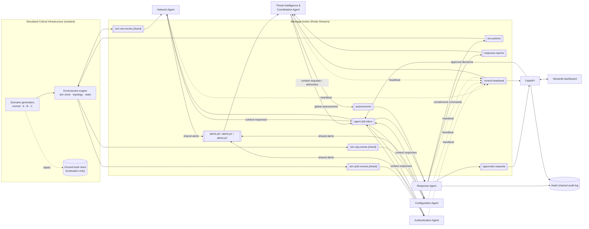
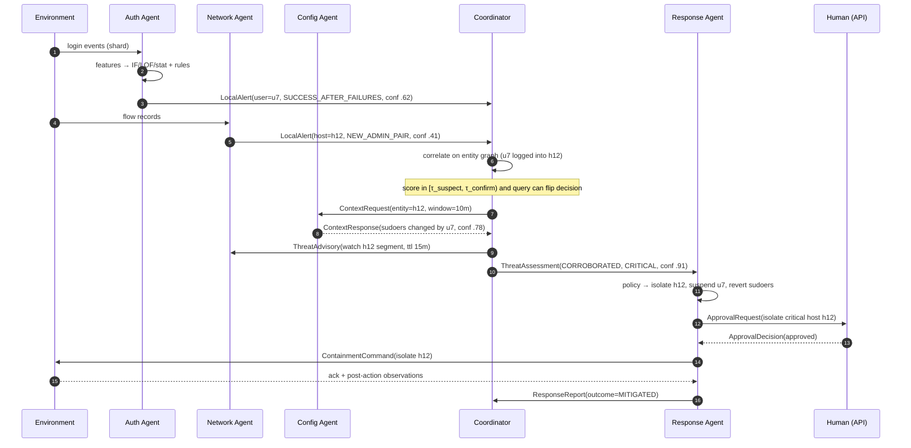
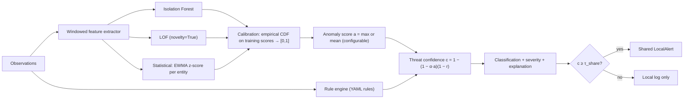
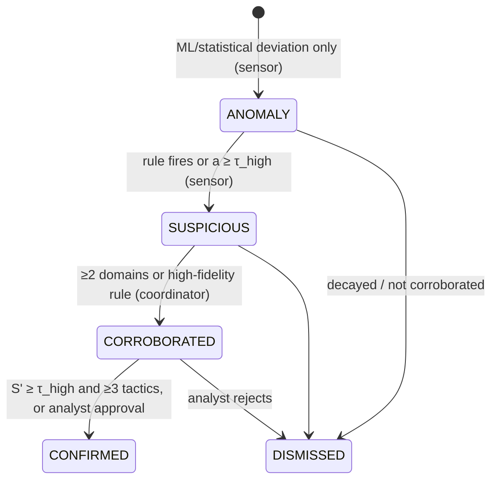

# Multi-Agent Cyber Defense System — Phase 1 Architecture

> Status: **design document (Phase 1), implemented in Phases 2–10.** Deviations found necessary during implementation are marked as refinements. This is a research prototype that runs on simulated infrastructure. It is not a production security product.

---

## 0. Design principles

| # | Principle | Consequence in the design |
|---|-----------|---------------------------|
| P1 | **No hidden centralisation** | Every agent runs its own asyncio event loop (one OS process per agent in Docker). Agents interact **only** through the broker. No shared memory and no direct function calls. The in-memory broker used in tests still serialises every message to bytes, so object references cannot leak between agents. |
| P2 | **Data minimisation** | Raw observations never leave the agent that collected them. Agents share *alerts* (summaries with bounded evidence) and answer *targeted context requests*. |
| P3 | **Anomaly ≠ malicious** | The confidence levels form an explicit ladder (§6.4). Sensor agents can only say "anomalous" or "suspicious". Only the coordinator can say "corroborated" or "confirmed", and "confirmed" still means *confirmed by the system*. Evaluation against ground truth is separate. |
| P4 | **Honest evaluation** | Ground-truth labels are written to a store that agents cannot access. Thresholds are tuned on validation seeds and reported on separate test seeds. Every number comes from logged runs. |
| P5 | **Reproducibility** | Simulated clock, seeded RNG (`numpy.random.Generator`), and versioned YAML configs. Each run writes a manifest (config hash, seed, git commit, broker backend). |
| P6 | **Safe by construction** | Attacks are synthetic event generators. Responses change only the simulator's state. No sockets point at real hosts. |

---

## 1. System architecture

### 1.1 Layers

```
┌───────────────────────────────────────────────────────────────────────────┐
│ Presentation    Streamlit dashboard  ◄── REST/WebSocket ──  FastAPI       │
├───────────────────────────────────────────────────────────────────────────┤
│ Decision        Intelligence & Coordination Agent   Response Agent        │
├───────────────────────────────────────────────────────────────────────────┤
│ Sensing         Network Agent(s)   Authentication Agent(s)   Config Agent(s)│
├───────────────────────────────────────────────────────────────────────────┤
│ Communication   MessageBroker interface → RedisStreamsBroker | InMemoryBroker│
│                 + NetworkConditions middleware (delay, loss, partition, budget)│
├───────────────────────────────────────────────────────────────────────────┤
│ Environment     Simulated infrastructure (segments, hosts, users, configs) │
│                 + scenario generators + ground-truth store (agents can't read)│
└───────────────────────────────────────────────────────────────────────────┘
        Telemetry plane (out-of-band): metrics collector, audit log, run manifest
```

There are two planes:

- **Control/data plane.** The messages agents use to make decisions. Communication overhead is measured on this plane.
- **Telemetry plane.** Timings, counters and resource samples go to a separate collector stream. Agents **never consume it**, so measurement cannot influence decisions. Its traffic is reported separately and is not counted as coordination overhead.

### 1.2 Component diagram



### 1.3 Deployment view

- **Docker Compose:** `redis`, `environment`, `agent-network`, `agent-auth`, `agent-config`, `agent-intel`, `agent-response`, `api`, `dashboard`. Each agent is its own container and process. Sharded sensor agents are scaled with `--scale` plus a `SHARD_ID` env var.
- **Local, no Docker** (current dev machine): `python -m mcd.runtime.launch --broker memory` runs every agent as an independent asyncio task in one process, or `--broker redis --processes` runs one process per agent against a local Redis. Both use the same agent code and the same `MessageBroker` interface.

### 1.4 Refined repository layout

This keeps the suggested structure. Changes: a `core/` package for shared contracts, broker *transports* split from the protocol, and per-domain feature extractors kept separate from detectors.

```
multi-agent-cyber-defense/
├── src/mcd/
│   ├── core/            models.py (Pydantic schemas), enums.py, clock.py, config.py, ids.py
│   ├── communication/   message.py (envelope), message_broker.py (ABC),
│   │                    transports/redis_streams.py, transports/memory.py,
│   │                    conditions.py (delay/loss/partition/budget), coordination.py
│   ├── agents/          base_agent.py, network_agent.py, authentication_agent.py,
│   │                    configuration_agent.py, intelligence_agent.py, response_agent.py
│   ├── detection/       features/{network,auth,config}.py, anomaly_detector.py,
│   │                    rule_engine.py, threat_scoring.py, explain.py
│   ├── simulation/      environment.py, topology.py, normal_activity.py,
│   │                    credential_compromise.py, lateral_movement.py,
│   │                    configuration_tampering.py, ground_truth.py
│   ├── response/        response_engine.py, policies.py, approval.py, audit_logger.py
│   ├── baseline/        centralized_detector.py
│   ├── evaluation/      metrics.py, experiments.py, statistics.py, visualizations.py
│   ├── runtime/         launch.py, supervisor.py
│   └── api/             main.py
├── dashboard/app.py
├── configs/             topology.yaml, agents.yaml, scenarios/*.yaml, experiments/*.yaml
├── tests/               unit/, integration/
├── results/             (git-ignored) run outputs, figures, reports
├── docs/
├── Dockerfile, docker-compose.yml, pyproject.toml, requirements.txt, README.md
```

Why: a `src/` layout prevents tests from importing the working tree by accident. `core/models.py` is the single contract every component depends on. Separating transports lets the protocol and agent tests run without Redis.

---

## 2. Agent responsibilities and boundaries

Every agent follows the same **observe → analyse → assess → share → decide → act** loop from `BaseAgent`. What changes between agents is *what they can observe* and *what they can do*.

| Agent | Observes (private) | Local state (never shared) | Shares | Decides | Acts |
|---|---|---|---|---|---|
| **Network** | Flow records from its segment shard: src, dst, ports, bytes, duration, status | Per-host sliding windows, communication-pair baseline, fitted IF/LOF models | `LocalAlert`s (lateral-movement indicators, scans, unusual pairs); `ContextResponse` about its hosts | Whether a window is anomalous/suspicious; whether to share; local monitoring intensity | Raises its own sampling/window resolution on advisories |
| **Authentication** | Login events: user, src host, dst host, result, method, time | Per-user and per-source baselines, failure counters, models | Alerts for brute force, spraying, success-after-failures, novel source, off-hours privileged logins | Same | Same |
| **Configuration** | Config change events and periodic state snapshots (key → value hash) | Baseline config hashes, authorised actors, maintenance windows | Alerts for unauthorised change, privilege escalation, drift, audit/firewall disablement | Same | Same |
| **Intelligence & Coordination** | **Only** alerts, context responses, response reports, heartbeats. **No raw events.** | Entity graph, incident windows, domain reliability weights, agent health table | `ThreatAssessment`s to Response; targeted `ContextRequest`s and `ThreatAdvisory`s to the agents that own the relevant entities | Correlation, global severity, whether to query, whether to escalate | Coordination only. It never touches the environment. |
| **Response** | Assessments, approval decisions, environment action acknowledgements | Incident response history, action cooldowns | `ResponseReport`s and `ApprovalRequest`s | Action selection from policy and blast radius; whether human approval is needed | Publishes containment commands to `env.actions`; evaluates mitigation outcome |

**Ownership rule.** Each sensor agent instance owns a set of entities: hosts by segment or shard hash, users by hash, config items by host. The coordinator sends a context request only to the owner of the entity in question. This is how communication stays targeted instead of broadcast.

**Autonomy.** In both coordination modes, sensor agents keep detecting and alerting even if the coordinator is down. The coordinator keeps working if a sensor dies: it marks that domain *degraded* and lowers the confidence it puts in "absence of evidence" from that domain.

---

## 3. Communication protocol

### 3.1 Broker choice: Redis Streams

| Need | Redis Streams | RabbitMQ |
|---|---|---|
| Async Python client | `redis.asyncio` | `aio-pika` |
| Consumer groups, ack, redelivery | `XREADGROUP`, `XACK`, `XAUTOCLAIM` | yes |
| Replay for analysis / dashboard | Native (append-only log, `XRANGE`) | Needs extra setup |
| Bounded memory | `XADD … MAXLEN ~` | queue limits |
| Ops footprint | 1 small container | heavier |

Redis Streams wins because **replay** (dashboard history, post-hoc metrics) and a small footprint matter more here than AMQP routing features. Redis has no native per-message priority, so priority is implemented with **priority lanes** (§3.4).

### 3.2 Streams (topics)

| Stream | Producer → Consumer | Delivery | Purpose |
|---|---|---|---|
| `sim.{net,auth,cfg}.events.{shard}` | Environment → owning sensor agent | consumer group, at-least-once | Raw synthetic observations. Labels removed. |
| `alerts.p0`, `alerts.p1`, `alerts.p2` | Sensors → Coordinator | consumer group | Shared alerts by priority lane |
| `alerts.direct` | Sensors → Response | consumer group | **Independent mode only** |
| `agent.{agent_id}.inbox` | Any → one agent | consumer group | Directed messages: context requests/responses, advisories, approval decisions |
| `assessments` | Coordinator → Response | consumer group | Global threat assessments |
| `env.actions` | Response → Environment | consumer group | Simulated containment commands |
| `response.reports` | Response → Coordinator, API | fan-out (separate groups) | Action outcomes |
| `approvals.requests` | Response → API | consumer group | Human-in-the-loop queue |
| `control.heartbeat` | All → Coordinator, API | fan-out | Liveness and load |
| `telemetry` | All → metrics collector | fire-and-forget | Measurement plane only |

### 3.3 Delivery semantics and failure handling

- **At-least-once** delivery through consumer groups. A message is `XACK`ed only after its handler succeeds.
- **Idempotency:** each consumer keeps an LRU of the `message_id`s it has processed, so redelivery has no effect.
- **Crash recovery:** on restart, an agent runs `XAUTOCLAIM` on pending entries older than `claim_idle_ms`, then resumes.
- **Poison messages:** after `max_deliveries` (default 5) a message moves to `dlq.{stream}`.
- **TTL:** messages carry `expires_at`. Expired alerts are dropped and counted, because stale threat information is worse than none.
- **Liveness:** heartbeat every 2 s (sim-time scaled). An agent is marked `DEGRADED` after 3 missed beats and `DOWN` after 10.
- **Back-pressure:** bounded `asyncio.Queue` between the reader task and the handler task. When it is full, P2 lanes are paused first.

### 3.4 Prioritisation

Priority comes from severity: CRITICAL/HIGH → P0, MEDIUM → P1, LOW/INFO → P2. The coordinator's reader polls `alerts.p0` first with a short block, then P1, then P2, with a starvation guard (at least 1 P2 read every *k* cycles). Directed inbox messages carry a `priority` field and are reordered locally in a priority queue.

### 3.5 Communication constraints (enforced, measurable)

A `CommunicationPolicy` wraps every agent's outbound path:

1. **Share threshold.** An alert is shared only if its local confidence is at least `τ_share`. `τ_share` sits *below* the local action threshold, so weak signals can still be corroborated.
2. **Suppression window.** At most one alert per `(entity, alert_type)` per `W_suppress`. Repeats are merged into the next alert as a `count`.
3. **Token-bucket budget** per agent, in messages/s and bytes/s. When the budget is exhausted, P2 traffic is dropped, then P1 is aggregated.
4. **Payload cap.** Evidence is limited to the top-*k* contributing features plus rule IDs, with no raw records. Messages above `max_bytes` are refused.

The **`NetworkConditions`** middleware sits between the policy and the transport. It injects delay (fixed or jittered), random loss, and partitions (drops traffic between named agent groups). This drives the robustness experiments with no change to agent code.

### 3.6 Interaction sequences



---

## 4. Message data structures

All messages use a common envelope (Pydantic v2, JSON on the wire). Below is the specification. The final code goes in `src/mcd/core/models.py` and `src/mcd/communication/message.py`.

```python
class Severity(IntEnum):      INFO=0; LOW=1; MEDIUM=2; HIGH=3; CRITICAL=4
class Priority(IntEnum):      P0=0; P1=1; P2=2
class Domain(StrEnum):        NETWORK; AUTH; CONFIG; INTEL; RESPONSE; ENV; HUMAN
class AssessmentStatus(StrEnum): ANOMALY; SUSPICIOUS; CORROBORATED; CONFIRMED; DISMISSED
class MessageType(StrEnum):   OBSERVATION; LOCAL_ALERT; CONTEXT_REQUEST; CONTEXT_RESPONSE;
                              THREAT_ADVISORY; THREAT_ASSESSMENT; CONTAINMENT_COMMAND;
                              ACTION_ACK; RESPONSE_REPORT; APPROVAL_REQUEST;
                              APPROVAL_DECISION; HEARTBEAT

class EntityRef(BaseModel):
    kind: Literal["host", "user", "config_item", "segment"]
    id: str

class Envelope(BaseModel, Generic[P]):
    message_id: str            # ULID: sortable, unique
    correlation_id: str | None # incident / conversation id
    causation_id: str | None   # message that caused this one
    schema_version: str = "1.0"
    type: MessageType
    sender: str                # agent_id, e.g. "auth-0"
    recipient: str | None      # None = topic broadcast
    topic: str
    priority: Priority
    severity: Severity | None
    sim_time: datetime         # simulated clock (detection semantics)
    created_at: datetime       # wall clock (latency measurement)
    expires_at: datetime | None
    hop_count: int = 0         # loop guard
    payload: P
```

**Payloads**

```python
class Observation(BaseModel):          # environment → sensor only. Never re-shared.
    event_id: str; domain: Domain; sim_time: datetime; attrs: dict[str, Any]
    # NOTE: no label. Labels live in ground_truth.py, keyed by event_id.

class Evidence(BaseModel):
    rule_ids: list[str]
    top_features: list[tuple[str, float, float]]   # (name, value, z-score vs baseline), k ≤ 5
    event_ids: list[str]                           # references only (≤ 20), not contents
    summary: str                                   # human-readable explanation

class LocalAlert(BaseModel):
    alert_id: str; domain: Domain
    entities: list[EntityRef]
    alert_type: str                                # e.g. "AUTH.SUCCESS_AFTER_FAILURES"
    tactic: str | None                             # kill-chain stage hint
    anomaly_score: float                           # [0,1] calibrated ML score
    rule_confidence: float                         # [0,1], 0 if no rule fired
    confidence: float                              # fused local threat confidence
    status: Literal["ANOMALY", "SUSPICIOUS"]       # sensors cannot claim more
    severity: Severity
    window: tuple[datetime, datetime]
    count: int = 1                                 # merged duplicates
    evidence: Evidence

class ContextRequest(BaseModel):
    request_id: str; entity: EntityRef; window: tuple[datetime, datetime]
    question: Literal["recent_alerts", "activity_summary", "baseline_deviation"]

class ContextResponse(BaseModel):
    request_id: str; entity: EntityRef
    max_confidence: float; alert_types: list[str]
    summary_stats: dict[str, float]                # bounded, aggregated. No raw data.

class ThreatAdvisory(BaseModel):                   # cooperative sensitivity boost
    entities: list[EntityRef]; reason: str
    share_threshold_delta: float                   # e.g. -0.15, clamped
    ttl_seconds: int

class ThreatAssessment(BaseModel):
    incident_id: str
    status: AssessmentStatus
    threat_class: str                              # CREDENTIAL_COMPROMISE | LATERAL_MOVEMENT | CONFIG_TAMPERING | MULTI_STAGE | UNKNOWN
    global_confidence: float; severity: Severity
    entities: list[EntityRef]
    contributing_alerts: list[str]; domains: list[Domain]
    tactics_observed: list[str]
    explanation: str
    first_seen: datetime; last_updated: datetime

class ContainmentCommand(BaseModel):
    action_id: str; incident_id: str
    action: Literal["ALERT_ONLY", "SUSPEND_ACCOUNT", "ISOLATE_HOST",
                    "REVERT_CONFIG", "INCREASE_MONITORING", "ESCALATE_HUMAN"]
    target: EntityRef; params: dict[str, Any]

class ApprovalRequest(BaseModel):  action_id: str; command: ContainmentCommand; rationale: str; deadline: datetime
class ApprovalDecision(BaseModel): action_id: str; approved: bool; operator: str; comment: str | None

class ResponseReport(BaseModel):
    action_id: str; incident_id: str; action: str; target: EntityRef
    executed_at: datetime | None
    outcome: Literal["MITIGATED", "PARTIAL", "INEFFECTIVE", "REJECTED", "TIMED_OUT", "PENDING"]
    post_action_signal: dict[str, float]

class Heartbeat(BaseModel):
    agent_id: str; domain: Domain; state: Literal["STARTING", "RUNNING", "DEGRADED", "STOPPING"]
    queue_depth: int; processed: int; cpu_pct: float; rss_mb: float
```

**Three levels of information, kept distinct by type:**

| Level | Type | Lives in | Visible to |
|---|---|---|---|
| Local observation | `Observation`, feature windows | sensor agent memory | that agent only |
| Shared alert | `LocalAlert`, `ContextResponse` | broker | coordinator (and response, in independent mode) |
| Global assessment | `ThreatAssessment` | coordinator → broker | response agent, API, dashboard |

---

## 5. Cooperative decision-making algorithm

### 5.1 Strategies compared

| Strategy | Who decides | Messages |
|---|---|---|
| **S1 Independent** | Each sensor agent. It sends `alerts.direct` to Response when local confidence ≥ `τ_act`. The coordinator is off. | 1 per actionable alert |
| **S2 Cooperative** | The coordinator decides, using correlated alerts plus targeted queries. Sensors share at `τ_share < τ_act`. | Alerts + few context requests + advisories |
| **S3 Centralised baseline** | One process receives *all raw events* and runs the same feature extractors, detectors, rules and correlator. There is no inter-agent messaging. | Raw event volume to one node |

All three use the **same detectors and rules**. Only the decision architecture changes, so differences between them can be attributed to coordination.

### 5.2 Correlation: entity-centric incident graph

The coordinator keeps a bipartite graph of *alerts* ↔ *entities* inside a sliding window `W_corr` (default 30 sim-min). It also adds **relationship edges** learned from alert evidence (user `u` logged into host `h`; host `h` connected to `h'`). An **incident** is a connected component of this graph within the window. New alerts either merge into an existing incident or open a new one.

### 5.3 Global confidence: deduplicated noisy-OR with decay and kill-chain bonus

For incident *I*:

1. **Deduplicate.** For each key `(domain, alert_type, entity)`, keep only the maximum confidence. This stops one noisy detector from inflating the score through repetition.
2. **Time decay:** `c_i(t) = c_i · 2^{-(t - t_i)/h}`, with half-life `h`.
3. **Reliability weighting:** `w_d ∈ (0,1]` is the precision of domain *d*'s alerts **measured on validation seeds**, so it is data-driven rather than hand-set.
4. **Noisy-OR fusion:** `S = 1 − Π_i (1 − w_{d(i)} · c_i(t))`
5. **Kill-chain coherence.** Let *k* be the number of distinct tactics observed in plausible temporal order (credential access → lateral movement → privilege escalation/persistence). Then `S' = 1 − (1 − S) · γ^{(k−1)}` with `γ = 0.7`.
6. **Severity** = `f(S', max asset criticality among entities)` through a 5×3 matrix.

### 5.4 Decision rule with value-of-information querying

> **Refinement made during implementation (Phase 5).** Development runs (seeds 1–5) showed that a legitimate
> admin session appears in *two* domains at once (network: new admin-port pair; auth: novel critical
> destination). Counting those as independent corroboration produced false positives. The corroboration
> condition therefore became: `≥ 2 domains AND (kill-chain length ≥ 2 OR a rule ≥ 0.7)`, or a single
> high-fidelity rule (≥ 0.95). In addition: (a) shared-service hosts (DC, file, mail, web, app, DB, backup)
> and sweep-like alerts (> 3 related entities) never merge incidents; (b) response targets are only entities
> named in real alerts (never context answers) with decayed confidence ≥ 0.55 or evidence from ≥ 2 domains;
> (c) the coordinator never queries about hub entities.

```
on new alert or context response for incident I:
    update graph, recompute S'(I)
    if S'(I) ≥ τ_confirm and ((|domains(I)| ≥ 2 and (k ≥ 2 or max_rule ≥ 0.7)) or max_rule_conf(I) ≥ 0.95):
        status ← CORROBORATED (CONFIRMED if τ_high and ≥ 3 tactics); publish assessment
    elif S'(I) ≥ τ_suspect:
        for each related entity e whose owner domain d ∉ domains(I) and not yet queried:
            # value of information: query only if the answer could flip the decision
            if 1 − (1 − S'(I))·(1 − w_d) ≥ τ_confirm and budget allows:
                send ContextRequest to owner(e)          # targeted, not broadcast
        send ThreatAdvisory to owners of I's entities    # lower τ_share locally, with TTL
        status ← SUSPICIOUS (assessment published only if severity ≥ MEDIUM)
    else:
        keep in window; drop when decayed below ε
    if owner(e) is DOWN: do not query; mark "domain unavailable" in explanation
```

Why this design:

- **False positives drop** because a single-domain anomaly rarely reaches `τ_confirm` without corroboration. The exception is a high-fidelity rule.
- **Detection improves** because sensors share sub-threshold signals, which can add up to a confident incident.
- **Communication stays low** because queries are *pulled* only when they could change the outcome (the VOI check) and only from the entity's owner. Advisories go only to owners, never to everyone.
- **Degradation is graceful** because a missing domain removes a term from the product instead of blocking the decision.

All thresholds (`τ_share, τ_act, τ_suspect, τ_confirm`) are set in `configs/agents.yaml` and tuned on validation seeds with a target FPR. They are frozen before test runs.

### 5.5 Response policy and human in the loop

The response agent maps `(threat_class, severity, global_confidence, asset criticality)` to a list of actions, using a declarative policy table. Each action has a **blast radius** (`low`: alert, increase monitoring; `medium`: suspend a non-privileged account, revert a config item; `high`: isolate a host, suspend a privileged account, any action on a CRITICAL asset).

- Low or medium blast radius with confidence ≥ policy threshold: execute automatically.
- High blast radius: send an `ApprovalRequest`. Approve or reject happens in the API/dashboard. **When the deadline passes, the agent falls back to a safe action** (INCREASE_MONITORING + ESCALATE_HUMAN). It never executes the critical action on its own. For unattended experiments, an `auto_approver` stub with a configurable policy and latency stands in for the human, and this is reported explicitly.
- **Cooldowns and idempotency** stop the same action on the same target from repeating.
- **Outcome evaluation.** The environment applies the command: an isolated host emits or accepts no flows, a suspended account's logins fail, a reverted config returns to baseline. During a post-action window `T_eval`, the response agent watches follow-up signals (reports, alerts on the same entities). Outcome is MITIGATED if no further related alerts arrive, PARTIAL if they decrease, INEFFECTIVE otherwise. Separately, the evaluator checks against **ground truth** whether the attack actually stopped progressing. Both numbers are reported, because the agent's own judgment can be wrong.

**Audit log:** append-only JSONL. Each record holds `{incident, responsible_agent, evidence, confidence, action, approval, executed_at, outcome, prev_hash, hash}` and is SHA-256 hash-chained, so tampering is evident. It also mirrors to a `audit` Redis stream for the dashboard.

---

## 6. Machine learning approach

### 6.1 Hybrid pipeline (per agent, fully local)



### 6.2 Features by agent (windowed per entity, default 60 sim-s)

| Agent | Entity window | Features |
|---|---|---|
| Network | source host | flows, unique dst hosts, unique dst ports, admin-port flows (22/3389/445/5985), bytes out/in ratio, failed-connection ratio, **new-pair ratio** (pairs unseen in baseline), cross-segment flow ratio, segment-criticality jump |
| Auth | user, and source host | failures, successes, failure ratio, success-after-*n*-failures flag, distinct source hosts, distinct users per source (spraying), off-hours flag, novel-source flag, privileged-account flag |
| Config | host (event-driven + periodic) | changes per window, changes outside maintenance window, unauthorised actor flag, security-critical key touched (sudoers, firewall, audit, services), privilege delta, drift distance (# keys whose hash differs from baseline) |

**Note on the configuration domain.** Config events are sparse and semantically rich, so **rules dominate** and ML adds only a rate-anomaly signal. The design accepts this and the evaluation reports it, rather than forcing ML where it does not fit.

### 6.3 Training and calibration

- **Unsupervised.** Models are fitted on a warm-up period of *normal-only* activity, generated with seeds disjoint from the test seeds. No attack labels are used for training.
- Normal activity deliberately includes **benign confounders**: a vulnerability-scanner host, nightly backup bursts, admin maintenance windows with legitimate config changes, users who mistype passwords. Without these, FPR would be trivially low.
- **Calibration.** A raw IF/LOF score is mapped to its percentile among training scores, which makes models comparable and gives an interpretable `a ∈ [0,1]`.
- Statistical detectors use online EWMA mean/variance per entity, so they adapt to drift. Online updating is *frozen* for flagged windows, so an attacker cannot poison the baseline.
- Optional periodic re-fit on recent windows that were not flagged. This is off by default in experiments, for reproducibility.

### 6.4 Outputs and confidence ladder

Each alert includes: anomaly score, threat confidence, classification (rule-derived type, or `UNCLASSIFIED_ANOMALY` when only ML fired), severity, `sim_time` detection timestamp, and an explanation (fired rule IDs plus the top-*k* features by |z-score| against the entity baseline, rendered into a sentence).



The explanation is feature attribution against a baseline, not SHAP. It is cheap, deterministic and honest about what it is.

---

## 7. Attack simulation environment

- **Topology** (`configs/topology.yaml`), modelled on a small critical-infrastructure site. Segments are `DMZ`, `CORP`, `SERVERS`, `OT` (SCADA/HMI), each with a criticality of 1–3. Hosts belong to segments, users have roles (standard, admin, service), and each host has a set of config items. Allowed segment-to-segment flows are defined.
- **Simulated clock** with a speed-up factor. Detection semantics use sim time; system latency uses wall-clock time.
- **Generators** are seeded and composable:
  - Normal activity: Poisson/diurnal processes for flows, logins and maintenance changes, plus the confounders from §6.3.
  - **A Credential compromise:** brute force or spraying against *n* users, then a successful login from a novel source, then off-hours access to unusual hosts.
  - **B Lateral movement:** starting at a compromised host, admin-port connections hop progressively CORP → SERVERS → OT, with a configurable dwell time between hops.
  - **C Configuration tampering:** unauthorised changes to sudoers/firewall/audit outside maintenance windows, drift injections, and privilege grants.
  - A **multi-stage** composite (A → B → C) to evaluate cross-domain correlation.
- **Scenario parameters:** `start`, `duration`, `frequency` (campaigns per run), `intensity` (events/min), `affected_hosts`, `affected_users`, `stealth` (scales feature deviation toward normal).
- **Environment state reacts to responses**, so containment changes what happens next. Isolated hosts cannot progress the lateral-movement chain.
- **Ground truth** goes to `ground_truth.parquet` as `(event_id, attack_id, scenario, stage, entity, t_start, t_end)`. Agents have no access to it; only the evaluator reads it.

---

## 8. Experimental methodology

### 8.1 Protocol

- **Seeds:** 5 validation seeds for threshold tuning, then **≥ 10 test seeds** per configuration. Thresholds are frozen between the two phases.
- **Paired design:** S1, S2 and S3 run on the *same* seeds and event streams, which allows paired statistics.
- Every run produces a manifest, raw logs (alerts, assessments, actions, telemetry) and a metrics JSON. Figures are regenerated from these files only.

### 8.2 Metrics

| Category | Metric | Definition |
|---|---|---|
| Detection (incident level) | Detection rate / recall | fraction of attack campaigns with ≥1 actionable decision (S1: actionable alert; S2: assessment ≥ MEDIUM; S3: same rule as S2) on a true attack entity within `[t_start, t_end + grace]` |
| Detection (decision level) | Precision, F1 | fraction of actionable decisions that overlap a ground-truth attack entity-window |
| | FPR | false actionable decisions ÷ benign entity-windows |
| | Detection latency | first actionable decision sim-time − attack start (sim and wall-clock) |
| Distributed | Comm. overhead | messages and bytes per stream, per agent, per sim-hour (control plane only) |
| | Message latency | consumer receive wall-time − `created_at` (same host clock, p50/p95/p99) |
| | Processing time | per-event and per-window handler time per agent |
| | Resources | CPU % and RSS per agent process (psutil), Redis memory |
| Response | Mitigation rate | fraction of incidents whose attack stopped progressing after the action (ground truth), plus agreement with the agent's self-assessed outcome |

### 8.3 Experiments

| ID | Question | Independent variable | Levels |
|---|---|---|---|
| E1 | Does cooperation help? | strategy | S1, S2, S3 × scenarios A, B, C, multi-stage |
| E2 | Scalability | number of sensor agents *N* (hosts and events scale proportionally) | 2, 4, 8, 16 |
| E3 | Agent failure | kill a sensor or the coordinator at *t*, optional restart | none / 1 sensor / coordinator |
| E4 | Communication delay | injected delay | 0, 100 ms, 500 ms, 2 s (+ jitter) |
| E5 | Partial disconnection | partition between groups / loss probability | 0, 10, 30, 50 % |
| E6 | Missing observations | fraction of events dropped at sensor input | 0, 10, 25, 50 % |
| E7 | Noisy input | Gaussian noise on numeric attributes + extra benign bursts | σ ∈ {0, 0.1, 0.3} |
| E8 | Ablation | remove IF / LOF / stats / rules / VOI querying / advisories | one at a time |

**Scaling definition for E2.** *N* = total sensor agent instances, assigned round-robin to domains, with entities sharded by consistent hashing within each domain. The coordinator and response agent are fixed and counted separately. At *N* = 2 there is no configuration agent, so scenario C is reported as not covered. This is a real effect of the topology, not a missing result.

### 8.4 Statistics and reporting

- Mean ± 95 % bootstrap CI over seeds for each metric.
- Paired comparisons (S2 vs S1, S2 vs S3): **Wilcoxon signed-rank** with Holm correction, plus effect size (rank-biserial *r*).
- Plots (Plotly, exported to HTML and PNG): grouped bars with CIs (E1), latency/overhead vs *N* on log scale (E2), metric-vs-degradation curves (E3–E7), ablation deltas (E8), and latency CDFs.
- An auto-generated `results/report.md` cites the run IDs behind every number.

---

## 9. Implementation milestones

| Phase | Deliverable | Acceptance criteria (must pass before moving on) |
|---|---|---|
| **1** | This document | Reviewed and agreed |
| **2** | `core/` models, `MessageBroker` ABC, in-memory + Redis transports, `CommunicationPolicy`, `NetworkConditions`, `BaseAgent` lifecycle (start/stop, heartbeat, reader/handler tasks, ack, dedup, DLQ) | Unit tests for schemas and serialisation round-trip; transport contract tests run against both backends (Redis tests skipped when Redis is unavailable); two dummy agents exchange messages with ack and crash recovery |
| **3** | Network, Auth, Config, Intel, Response agent skeletons with rule-only detection | Integration test: hand-crafted events → expected alerts → assessment → command |
| **4** | Feature extractors, IF/LOF/EWMA, calibration, fusion, explanations | Detector unit tests on synthetic distributions; calibration is monotonic; explanations reference real features |
| **5** | Entity graph, noisy-OR scoring, VOI querying, advisories, S1/S2 switch | Unit tests for the scoring math; integration test showing corroboration raising confidence and query suppression |
| **6** | Topology, normal activity, scenarios A/B/C/multi-stage, ground truth, reactive env | Deterministic for a given seed (hash-identical streams); label leakage test (agents never receive label fields) |
| **7** | Response engine, policies, approvals with timeout fallback, hash-chained audit log | Tests: critical action never executes without approval; chain verification detects tampering |
| **8** | FastAPI (REST + WebSocket) and Streamlit dashboard (health, events, alerts, severity, comms graph, decisions, actions, incidents, metrics) | API tests with `httpx`; dashboard runs against a live simulation |
| **9** | Centralised baseline, experiment runner, metrics, statistics, figures, report | E1–E8 run end-to-end; every figure is traceable to run artifacts |
| **10** | README (diagrams, install, screenshots, results, limitations), Dockerfile, compose | `docker compose up` brings up the full system; fresh-clone quickstart works |

---

## 10. Known limitations (stated up front)

- Synthetic data is generated by our own models, so detection results measure performance **on this simulator**, not on real networks. Generator design and detector design can be unintentionally coupled. The `stealth` parameter and the benign confounders reduce this coupling but cannot remove it.
- Message latency is measured on a single host (shared clock). Multi-host clock skew is not modelled.
- The kill-chain model is simplified, and the order of tactics is hand-specified.
- The human-in-the-loop component is stubbed in unattended experiments.
- The coordinator is a logical single point for correlation in S2. Mitigations are sensor autonomy and the degraded mode. Sharded or gossip-based coordinators are future work.
- Not production-ready. There is no authentication or TLS between agents and the broker in the default compose file.
